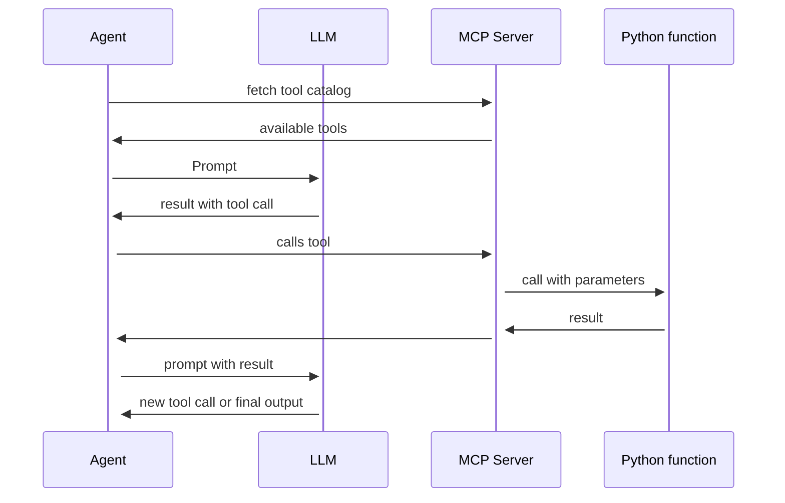

# Agents

Most agent loops are implementations of the ReAct pattern (Reason + Act), introduced in a 2022 paper by Google Research. The agent alternates between two modes:

    Reasoning — thinking through what to do, why, and what is likely to happen
    Acting — calling a tool, executing code or performing another concrete action

Or in a bit more detail:

1. the host sends the prompt **and all tool schemas** to the LLM
2. the LLM responds with text or with a **tool call** (`tool_use` block)
3. the host executes the call on the MCP server
4. the result goes back into the context, and the loop starts over
5. the loop ends when the task is done or a step or token limit is reached

This is the **ReAct** pattern: *Reason → Act → Observe → Repeat*.

> Running agents in a loop requires a large context window!

----

## When does the agent loop end?

Every loop needs an exit. Common termination conditions are:

- task completed
- maximum number of iterations reached (e.g. 50 steps)
- context window or cost limit reached
- human checkpoint — pause and wait for confirmation by the user
- too many errors in a row, abort
