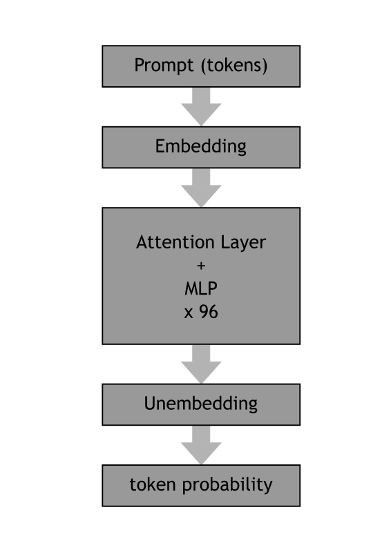

# Fundamentals

## Architecture of an LLM

*exemplary structure of ChatGPT*

### Exercise 1: Fill in the gaps

Insert the words:
**neural network, LLM, context, tokens, prompt, user prompt, system prompt, temperature**

> A \_\_\_\_\_\_\_\_ is a mathematical model made of many layers of simple units.
> An \_\_\_\_\_\_\_\_ is a very large one, trained to predict the next word.
> Before processing, text is split into \_\_\_\_\_\_\_\_.
> The text we send to the model is called the \_\_\_\_\_\_\_\_.
> It consists of a \_\_\_\_\_\_\_\_, written by the developers of the application,
> and a \_\_\_\_\_\_\_\_, typed in by the person using the application.
> Everything the model can see at once is called the \_\_\_\_\_\_\_\_.
> The \_\_\_\_\_\_\_\_ controls how random the choice of the next token is.

Solution

neural network, LLM, tokens, prompt, system prompt, user prompt, context, temperature

### From neurons to transformers

- a **neuron** multiplies its inputs by weights, sums them up and applies a nonlinear function
- a **neural network** stacks many layers of neurons; during training the weights are adjusted
- text is split into **tokens** (words or parts of words), and each token is converted into a vector (**embedding**)
- a **transformer** uses **attention**: each token looks at all previous tokens to decide what is important
- the output is a probability for each possible next token
- an **LLM** does nothing but **next-token prediction** – over and over again

----

## Current models

| Model | Provider | Open Weights | Parameters | Context (tokens) |
|-------|--------|:------------:|-----------:|-----------------:|
| GPT-3 (2020, for comparison) | OpenAI | no | 175 B | 2 K |
| GPT-5.3 | OpenAI | no | ? | 128 K |
| Claude Sonnet / Opus / Fable | Anthropic | no | ? | 1 M |
| Gemini | Google | no | ? | ≥ 1 M |
| DeepSeek-V4-Pro | DeepSeek | yes | 1.6 T (49 B active) | 1 M |
| DeepSeek-V4-Flash | DeepSeek | yes | 285 B (13 B active) | 1 M |
| Qwen3-Max | Alibaba | no | > 1 T | 1 M |
| Qwen3-0.6B | Alibaba | yes | 0.6 B | 32 K |

- **Frontier models** run in the provider's cloud. They are the most powerful, but your data leaves the building.
- **Open-weight models** can be downloaded and run locally (e.g. with Ollama). They are weaker, but you stay in control.

**Question:** Which of these models have you used already? How good were they?

### Exercise 2:

Have a look at [Simon Willison's pelican collection](https://simonwillison.net/tags/pelican-riding-a-bicycle/). What do the images tell you about the practical limits of LLMs?

## LLMs have improved significantly

- **Tool use:** models are trained to output structured tool calls (MCP builds on this)
- **Reasoning:** models "think" in additional tokens before they answer
- **longer context:** from 2 K to 1 M tokens in 6 years
- **Agents:** models call tools in a loop until a task is done
- **Training:** models are specifically trained to deliver structured output such as program code or JSON

## Some limitations remain

- **Context:** is still a scarce resource: everything the model knows about your task has to fit into the context: system prompt, conversation, tool descriptions and tool results.
- models are worse at finding details in very long contexts
- every connected MCP tool costs context, even if it is never used
- models still hallucinate
- models still cannot think, calculate or follow logical chains that are deeper than the depth of the LLM. However, they are good at writing code that performs the deeper calculations.

### Exercise 3: Fibonacci

Let's examine the capabilities of an LLM using the Fibonacci sequence (0, 1, 1, 2, 3, 5, 8, ...).

1. Ask ChatGPT (or another LLM) to calculate the 5th Fibonacci number, then the 100th, the 231st or an even higher one – **without** letting it execute code.
2. Write a Python function `fibonacci(n)` that returns the n-th number of the Fibonacci sequence.
3. Compare the results.

> Why should an LLM call a function instead of "knowing" the answer?

----

## Reflection questions

Collect and discuss:

1. Where does your company use AI **today**?
2. Which tasks could an AI do **in the future** if it had access to your systems?
3. Which systems would it need to access?
