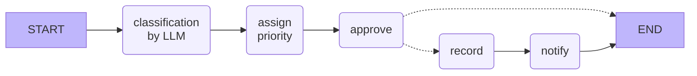
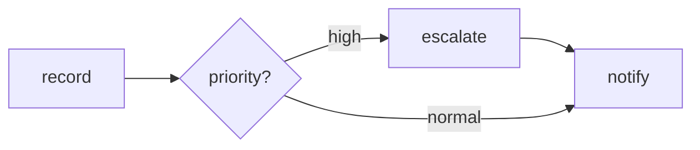

# Workflows with LangGraph

An **agent** decides by itself which tool to call next.
A **workflow** defines the steps – the LLM is only asked where it is needed.

### An example workflow for incidents



In **LangGraph** a workflow consists of:

| Term | Meaning |
|---------|-----------|
| **State** | a dictionary that is passed on from step to step |
| **Node** | a Python function that reads the state and returns changes |
| **Edge** | defines which node comes next |
| **Conditional Edge** | a function decides which node comes next |

The library `langchain-mcp-adapters` makes MCP tools available in LangGraph:

```python
from langchain_mcp_adapters.client import MultiServerMCPClient

mcp_client = MultiServerMCPClient(
    {"incidents": {"url": "http://localhost:8000/mcp", "transport": "streamable_http"}}
)
tools = await mcp_client.get_tools()
```

----

## Exercise 1: Run a workflow

### Step 1: Create a separate project

`langchain-mcp-adapters` requires an older version of the `mcp` package than FastMCP.
Since the workflow is only a client, it gets its own project.

Create a new directory and set up a project there:

```bash
uv init workflow
cd workflow
uv add langgraph langchain-mcp-adapters langchain-ollama
ollama pull qwen3:0.6b
```

### Step 2: Start the workflow

Start the incident server from [code/incident_mcp.py](code/incident_mcp.py) in the first terminal.
Download [code/graph/incident_workflow.py](code/graph/incident_workflow.py) into the `workflow` project and run it:

```bash
uv run incident_workflow.py
```

The script prints the graph as a Mermaid diagram. Paste it into [mermaid.live](https://mermaid.live).

### Step 3: Read the code

- Which node uses the LLM? Which one an MCP tool?
- How does the LLM's classification get into a Pydantic class?
- Change the message in `__main__` and try out different incidents.

----

## Exercise 2: Escalation

High-priority incidents should additionally be escalated to the IT manager.



Add a node `escalate` and a conditional edge.

<details>
<summary>Solution</summary>

```python
def escalate(state: State) -> State:
    print("🚨 escalated to the IT manager")
    return {}


def route(state: State) -> str:
    return "escalate" if state["priority"] == "high" else "notify"


graph.add_node(escalate)
graph.add_conditional_edges("record", route, ["escalate", "notify"])
graph.add_edge("escalate", "notify")
```

The edge `graph.add_edge("record", "notify")` has to be removed.

</details>

### Question

When is a fixed workflow better than a free agent? When is it the other way round?
