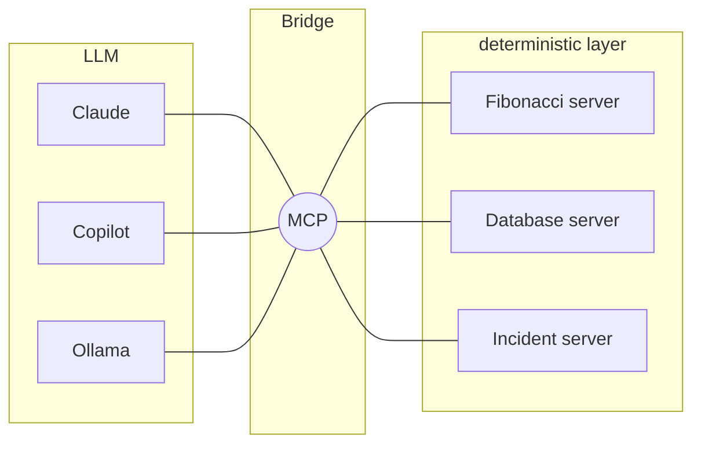

# The MCP Protocol

## Questions

- There are several Python libraries for MCP, including [`pymcp`](https://pypi.org/project/pymcp/) and [`fastmcp`](https://pypi.org/project/fastmcp/). Look up both on pypi.org. Which one would you choose?

----

## The N×M problem

Without a standard, every AI application needs its own integration for every tool:
**N applications × M tools = N·M integrations.**

With MCP, each application implements MCP once, and each tool implements MCP once:
**N + M integrations.** MCP is the *"USB-C port for AI"*.


----

## MCP as a bridge

MCP is an implementation of the [Bridge Pattern](https://refactoring.guru/design-patterns/bridge):
it separates the abstraction (what the AI wants to do) from the implementation (how a system does it), so that **both sides can change independently of each other**.



----

## What a conversation with an MCP service looks like behind the scenes:

All messages are sent in the **JSON-RPC 2.0** format. First, the client asks which tools are available:

```json
{"jsonrpc": "2.0", "id": 1, "method": "tools/list"}
```

The server describes each tool with a JSON schema:

```json
{
  "name": "add",
  "description": "Add two numbers",
  "inputSchema": {
    "type": "object",
    "properties": {"a": {"type": "integer"}, "b": {"type": "integer"}},
    "required": ["a", "b"]
  }
}
```

The user asks *"What is 17 + 25?"*. The LLM has been trained to respond with a tool call:

```json
{"name": "add", "arguments": {"a": 17, "b": 25}}
```

The client sends it to the server:

```json
{"jsonrpc": "2.0", "id": 2, "method": "tools/call",
 "params": {"name": "add", "arguments": {"a": 17, "b": 25}}}
```

----

### Reflection questions

- What are the differences between MCP, a REST API and calling Python functions directly?
- What are good use cases for each approach?
