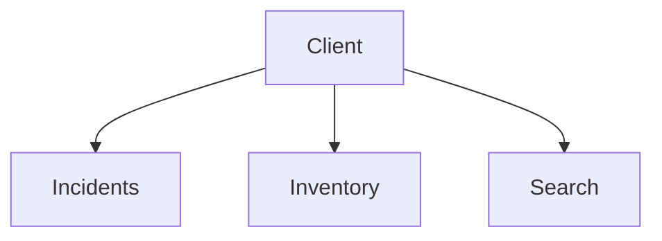
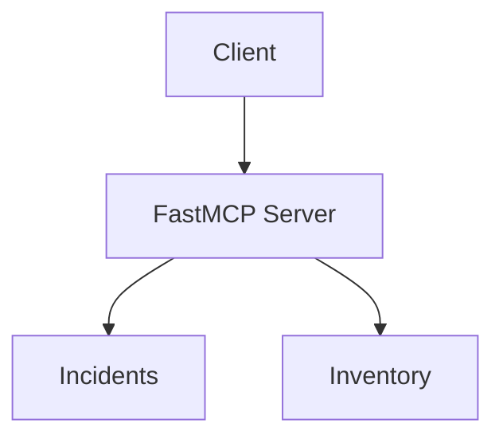
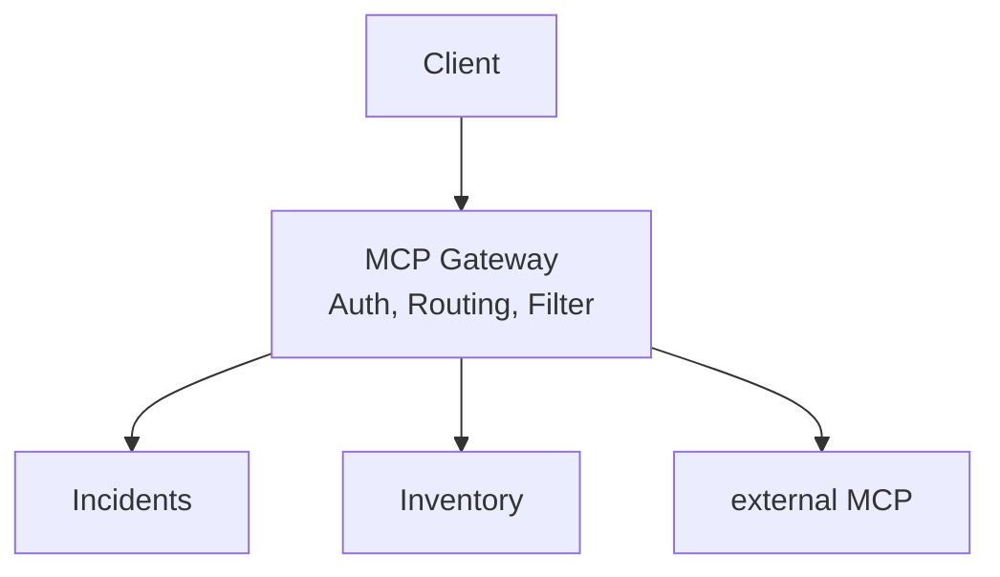

# Multiple MCP Servers

In practice, it rarely stays with a single server.
There are three common architectures:


### Option 1: LLM client connects to multiple MCP servers



### Option 2: one MCP server offers multiple tool groups



### Option 3: a gateway connects multiple MCP servers



----

## Exercise 1: Compose servers

With `mount()` you combine multiple FastMCP servers into one.

Combine two MCP servers into one via a gateway:

```python
from fastmcp import FastMCP

from fibonacci_mcp import mcp as fibonacci_mcp
from incident_mcp import mcp as incident_mcp

gateway = FastMCP("Gateway")
gateway.mount(incident_mcp, namespace="incidents")
gateway.mount(fibonacci_mcp, namespace="fibonacci")
```

The `namespace` prevents name conflicts: `create_incident` becomes `incidents_create_incident`, `incident://{id}` becomes `incident://incidents/{id}`.

Solution: [code/gateway_mcp.py](code/gateway_mcp.py)


## Exercise 2: Publish an existing FastAPI app as MCP

`FastMCP.from_fastapi()` turns every endpoint of a FastAPI app into a tool:


```python
from inventory_api import app as inventory_app

inventory_mcp = FastMCP.from_fastapi(inventory_app, name="Inventory")
gateway.mount(inventory_mcp, namespace="inventory")
```


1. Download [code/inventory_api.py](code/inventory_api.py).
2. Install FastAPI: `uv add fastapi uvicorn`
3. Add the lines above to the gateway
4. Start the gateway and list all tools:

   ```bash
   uv run gateway_mcp.py
   uv run fastmcp list http://localhost:8000/mcp
   ```

5. Ask an LLM: *"Which devices are at the location of incident 1?"*
   Does it use tools from both servers?


## Exercise 3: Filter tools

The inventory also contains `delete_device`. An LLM should not be allowed to delete devices.
Exclude all `DELETE` endpoints:

```python
from fastmcp.server.providers.openapi import MCPType, RouteMap

inventory_mcp = FastMCP.from_fastapi(
    inventory_app,
    route_maps=[RouteMap(methods=["DELETE"], mcp_type=MCPType.EXCLUDE)],
)
```

If you have your own FastAPI app (e.g. from the FastAPI course), publish it the same way.


Solution: [code/gateway_mcp.py](code/gateway_mcp.py)
