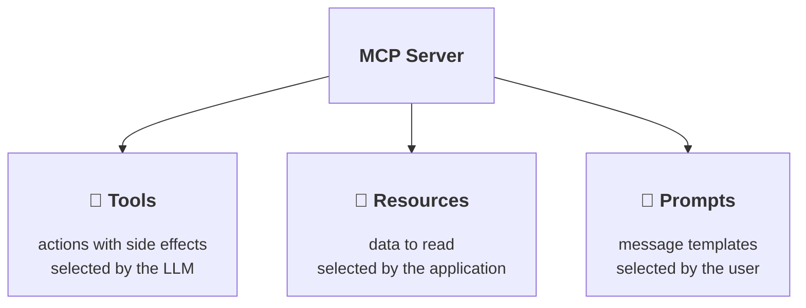

# Tools, Resources and Prompts

## Building blocks of MCP



| | Decorator | Example | Who decides on usage |
|--|-----------|---------|-----------------------|
| **Tool** | `@mcp.tool` | calculate, create an incident, send an e-mail | the LLM |
| **Resource** | `@mcp.resource("uri")` | configuration, status, a file, a database entry | the application / the user |
| **Prompt** | `@mcp.prompt` | "Review this code", "Write a reply to a customer" | the user |

----

## Exercise 1: Add a static resource

Create a new resource. Fill it with a text describing the Fibonacci sequence:

```python
@mcp.resource("info://about")
def about() -> str:
    """Background information on the Fibonacci series."""
    return "The Fibonacci series starts with 0, 1. ..."
```

## Exercise 2: Add a resource template

The `{n}` in the URI becomes a function parameter:

```python
@mcp.resource("fibonacci://{n}")
def fibonacci_resource(n: int) -> dict:
    """The n-th Fibonacci number with its neighbours."""
    return {
        "n": n,
        "value": fibonacci(n),
        "next": fibonacci(n + 1),
    }
```

## Exercise 3: Read the resources

```bash
uv run fastmcp call http://localhost:8000/mcp info://about
uv run fastmcp call http://localhost:8000/mcp fibonacci://7
```

Also look at them in the MCP Inspector under **Resources** and **Resource Templates**.

In Claude Code, type `@` to attach a resource to your prompt.

----

## Exercise 4: Add a prompt template

```python
@mcp.prompt
def explain_number(n: int) -> str:
    """Asks the LLM to explain a Fibonacci number to a child."""
    return (
        f"Calculate the Fibonacci number at position {n} using the tools. "
        "Then explain to a 10-year-old how it was calculated."
    )
```

Render the prompt with

```bash
uv run fastmcp call http://localhost:8000/mcp --prompt explain_number n=12
```

## Exercise 5: Use the prompt in Claude Code

Type `/` in Claude Code. Find your prompt in the list (`/mcp__fibonacci__explain_number`) and run it.

Solution: [code/full_mcp.py](code/full_mcp.py)
